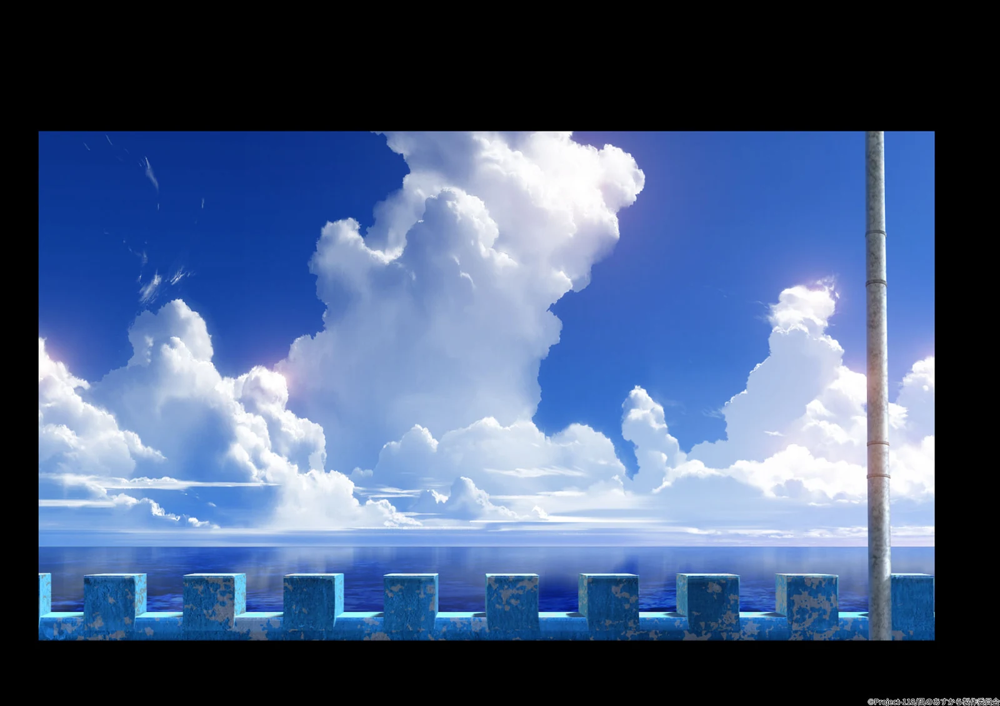

<div align="center">

# ekvido

**自訂的 darktable 濾鏡效果模組**<br>
Custom effect modules for darktable


</div>

## 這是什麼？ What?

因為我喜歡這個：<br>
Because I liked this:



<sub>《凪のあすから》背景美術，© Project-118／凪のあすから製作委員会。僅作為參考引用，不在本專案的 GPL 授權範圍內。<br>
Background art from *Nagi no Asukara*, © Project-118 / Nagi no Asukara Production Committee. Quoted for reference only; not covered by this project's GPL licence.</sub>

所以做了那個非常開源的行為(go fork myself)，讓 DarkTable 可以把這個：<br>
So I did the open source thing and go fork myself and made this, which can turn this:


<sub>自攝照片/Photo by me</sub>


變成這個：<br>
Into THIS:


<sub>自攝照片/Photo by me</sub>

## 兩個模組 The two modules

| 模組 Module | 功用 What it does |
|---|---|
| **ekvido kazuki** | 「Kazuki 光」：命名致敬《來自風平浪靜的明日》的美術監督 東地和生 先生。依照亮部本身的色相上色的光暈，陽光反射偏暖橘、環境光和月光偏深藍到青，形狀是柔和的十字或光芒。附啟發自 Clip Studio Paint 的混色模式（濾色、覆蓋、加亮顏色、發光加亮，以及「覆蓋（僅光暈）」），並具有拿別的模組的遮罩當作為輸入光源範圍。<br>"Kazuki light": Naming is a nod toward Mr. Higashiji Kazuki, the art director of "Nagi no Asukara". bloom coloured by each highlight's own hue (warm orange for sunlight reflections, deep blue to cyan for ambient light and moonlight), shaped as a soft cross or streaks instead of a round blob. Clip Studio Paint blend modes, plus an optional source mask borrowed from another module. |
| **ekvido mist** | 物理式的柔焦濾鏡（白霧／黑霧）：光暈強度跟著真實的場景亮度走，用核心＋光暈＋薄紗三層 PSF 做卷積。<br>Physically based diffusion (white / black mist): bloom strength follows true scene intensity, via a core + halo + veil PSF convolution. |

兩個模組都在 scene-referred 的線性資料上運作，放在 pipeline 裡 *blurs* 的正後方，有 OpenCL 時會跑在 GPU 上。<br>
Both work on scene-referred linear data, sit right after *blurs* in the pipe, and run on the GPU when OpenCL is available.

## ⚠️ 這是「軟分支」 Heads-up: this is a soft fork

ekvido **不是** 硬分支（一個另起爐灶、從此和上游分道揚鑣的 darktable），也 **不是** 真正的「外掛」：darktable 沒有讓第三方模組直接掛上去的介面。

它是一包 **整個檔案的替換**：我們新增的檔案，加上少數幾個被改過的 darktable 原始檔，綁定在某一個 darktable 版本（現在是 `release-5.6.2`，寫在 `darktable/UPSTREAM`）。每次建置都會從 GitHub 抓那個版本的官方原始碼，再把這些檔案蓋上去。

- 好處：你拿到的永遠是官方 darktable 加上 ekvido，沒有別的。
- 代價：只對那一個版本有效。darktable 出新版時，要由這邊更新版本綁定、重新檢查被改過的檔案，不能自己拿去套在任何版本上。
- 另外：用了 ekvido 模組的 XMP，拿去給一般版的 darktable 編輯，ekvido 的步驟會被丟掉。

ekvido is **not** a hard fork (a darktable that branches off and goes its own way), and **not** a true mod (darktable has no interface for third-party modules). It is a set of **whole-file replacements**: our new files plus a few edited darktable sources, pinned to one darktable tag (`release-5.6.2`, in `darktable/UPSTREAM`). Every build fetches that official source from GitHub and lays these files over it. You always get stock darktable plus ekvido and nothing else, but it only fits that one version: new darktable releases need the pin updated and the edited files rechecked here. XMP sidecars that use the ekvido modules lose those steps if a stock darktable edits them.

## 內容 What's here?

```
darktable/            darktable 那一側：放在原始路徑上的整個檔案 / whole files at their darktable paths
  UPSTREAM            綁定的上游 tag 和 commit / the pinned upstream tag and commit
  src/iop/ekvido*.c   兩個模組 / the two modules
  src/common/ekvido/  C 核心（CPU）、OpenCL 路徑（cl/）、獨立測試 / C core, OpenCL path, standalone tests
  data/kernels/ekvido.cl
  src/external/       內附的 VkFFT 1.3.4（MIT）和 PocketFFT（BSD-3-Clause）
  packaging/ekvido/   各平台的相依套件、建置、測試、打包、安裝腳本 / per-OS scripts
  po/ekvido/          翻譯（zh_TW）/ translations
  EKVIDO.md           darktable 那一側怎麼接起來的 / how the darktable side fits together
scripts/inject.sh     抓上游 darktable 再把 darktable/ 蓋上去 / clones upstream and lays darktable/ over it
src/ tests/ tools/    Python 原型、測試、fixture 和比對工具 / the Python prototype and its tools
assets/               這份 README 的圖 / images for this README
```

## 建置 Build

需要 / Requirements:
- [mise](https://mise.jdx.dev/) 和 git。<br>[mise](https://mise.jdx.dev/) and git, everywhere.
- **macOS**：Homebrew 和 Xcode command line tools。`mise run deps` 會從 darktable 的 `.ci/Brewfile` 裝套件，不會升級其他東西。<br>Homebrew + Xcode CLT; `mise run deps` installs from darktable's `.ci/Brewfile` without upgrading anything else.
- **Ubuntu 24.04**：`mise run deps` 會裝 `darktable/packaging/ekvido/ubuntu-24.04.txt` 裡的 apt 套件（會問 sudo）。<br>`mise run deps` installs the apt packages listed there (asks for sudo).
- **Windows**：MSYS2 裝在 `C:\msys64`，加上 Inno Setup 6（`winget install MSYS2.MSYS2` / `JRSoftware.InnoSetup`）。在 PowerShell 或 cmd 跑 mise 指令，它們會在 MSYS2 UCRT64 shell 裡執行腳本；第一次 clone 用 Windows 的 Git，`deps` 之後就能用 MSYS2 自己的 git。<br>MSYS2 at `C:\msys64` + Inno Setup 6. Run mise from PowerShell or cmd; the scripts run in an MSYS2 UCRT64 shell. The first clone uses Git for Windows; after `deps`, MSYS2's own git works too.

然後 / Then:
```bash
mise run deps      # 每台機器一次 / once per machine
mise run build     # 建置並安裝到這個系統的位置 / build and install into this OS's prefix
mise run test-c    # C 核心對照 fixture（一般和 fast-math 各一次）/ C core vs fixtures
mise run package   # macOS：app；Windows：安裝程式（Linux 什麼都不做）
mise run install   # 先備份 darktable 設定，再裝成日常使用的版本 / back up config, then install
```

第一次跑會把 darktable `release-5.6.2`（連同 submodule）從 GitHub clone 到 `.dt/darktable`，再把 `darktable/` 的檔案蓋上去。之後只會改寫有變動的檔案，建置是增量的。<br>
The first run clones darktable `release-5.6.2` with its submodules into `.dt/darktable` and lays `darktable/` over it; later runs only rewrite changed files, so builds stay incremental.

裝到哪 / Where things go:
- **macOS**：建到 `.dt/darktable/build/macosx`，`install` 會取代 `/Applications/darktable.app`（舊的丟到垃圾桶）。
- **Linux**：裝在 `~/.local/opt/darktable-ekvido`，有一個「darktable (ekvido)」的桌面捷徑。
- **Windows**：建到 `C:\msys64\opt\darktable-ekvido`，裝成 **darktable-dev**，和一般版 darktable 並存。

`install` 在 darktable 開著的時候不會動，而且一定先把設定備份到 `~/darktable-config-backups/`。各平台細節見 `darktable/EKVIDO.md`。<br>
`install` refuses to run while darktable is open and always backs up the config to `~/darktable-config-backups/` first. Per-OS details: `darktable/EKVIDO.md`.

## GPU

兩個模組都有 OpenCL 版本（FFT 用 VkFFT）。如果模組塞不進 darktable 允許的 GPU 記憶體，或跑到一半配置失敗，darktable 會讓那個模組那一次改用 CPU 跑：結果一樣，只是慢一點。Apple 的 GPU 走 CPU 路徑。`mise run test-cl` 會拿 GPU 結果對照 C 核心（需要 OpenCL GPU，並空出 4 GB）。在 RTX 4090 上匯出 1 億畫素：kazuki 9.2 秒 → 1.0 秒，mist 5.3 秒 → 0.75 秒。<br>
Both modules have an OpenCL path. If a module doesn't fit in the GPU memory darktable allows, or an allocation fails mid-run, darktable runs that module on the CPU for that run: same output, just slower. Apple GPUs use the CPU path. `mise run test-cl` checks the GPU against the C core (needs an OpenCL GPU with 4 GB free). On an RTX 4090, a 100 MP export takes kazuki from 9.2 s to 1.0 s and mist from 5.3 s to 0.75 s.

## Python 原型 Python prototype

一開始調參用的參考實作：CLI 加上一個瀏覽器滑桿介面，吃 darktable 匯出的 32-bit float 線性 TIFF。<br>
The reference implementation the look was tuned with: a CLI and a browser slider UI, working on 32-bit float linear TIFFs exported from darktable.

```bash
mise run test                                               # pytest
uv run ekvido ui in.tif                                     # 瀏覽器介面 / browser UI on http://127.0.0.1:8765/
uv run ekvido render in.tif -o out.tif --preset kazuki-default
uv run ekvido chart -o chart.tif                            # 合成測試圖 / synthetic test chart
```

介面操作：滾輪縮放、拖曳平移、雙擊符合視窗、按住 **B** 看原圖。設定會自動存到 `<image>.ekvido.json`，**render full** 輸出 `<image>.ekvido.tif`。`tools/make_c_fixtures.py` 重新產生 C 核心的 fixture，`tools/dt_compare.py` 拿 darktable-cli 的輸出和 Python 結果比對。<br>
In the UI: wheel = zoom, drag = pan, double-click = fit, hold **B** = before. Settings autosave to `<image>.ekvido.json`; **render full** writes `<image>.ekvido.tif`. `tools/make_c_fixtures.py` regenerates the C core's fixtures; `tools/dt_compare.py` compares a darktable-cli export against the Python result.

## 改 darktable 那一側 Changing the darktable side

直接改 `darktable/` 底下的檔案，再 `mise run build`；只有變動的檔案會被寫進 `.dt/darktable`。要改上游原本的檔案，先把它從 `.dt/darktable` 複製到 `darktable/` 的同一個路徑。`darktable/` 裡的檔案會整個取代上游的版本，因此只適用 `darktable/UPSTREAM` 裡的那個 tag。<br>
Edit files under `darktable/` and run `mise run build`; only changed files are rewritten into `.dt/darktable`. To change an upstream file, copy it from `.dt/darktable` into the same path under `darktable/` first. Files there replace upstream's whole, so they only fit the tag in `darktable/UPSTREAM`.

## 授權 Licence

GPL-3.0-or-later（見 `LICENSE`），和 darktable 一樣。VkFFT（MIT）和 PocketFFT（BSD-3-Clause）在 `darktable/src/external/` 底下保有各自的授權。`assets/reference.webp` 是版權所有的參考圖，不在 GPL 範圍內。<br>
GPL-3.0-or-later (see `LICENSE`), like darktable. VkFFT (MIT) and PocketFFT (BSD-3-Clause) keep their own licences under `darktable/src/external/`. `assets/reference.webp` is copyrighted reference art and is not covered by the GPL.
